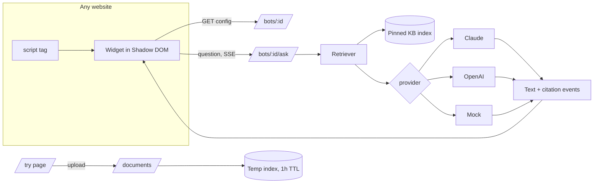

# PRD: docs-chat, a website support bot trained on your documents

Status: v2, revised for review (v1 was a full-page "chat with your PDF" app)
Shared rules: [STANDARDS.md](STANDARDS.md)

## 1. Overview

Small businesses get the same support questions over and over: shipping, returns, subscriptions, opening hours. They already have the answers in a help PDF or policy document. This project shows the product a client would actually buy: **a chat widget on their own website that answers visitors from the business's documents, cites the page it used, and hands off to a human when the documents don't cover the question.**

The demo is a believable sample business website, "Northwind Coffee Co.", a fictional coffee roaster. A chat bubble sits in the corner, and it answers from Northwind's customer help center PDF. The same widget installs on any website with one `<script>` tag, and a "Try it with your own PDF" page lets a prospect see their own bot in seconds.

**Portfolio goals:**
- Sell the service: "I can add a support bot to your website that answers from your documents."
- Prove Python/FastAPI backend skill, an embeddable frontend widget, and trustworthy grounding (citations and "I don't know" instead of guessing).

**Audience:**
- Small business owners and agencies who want a support bot on their site (Shopify, WordPress, Webflow, Squarespace, custom).
- Anyone checking Python/FastAPI and frontend skill.

## 2. Goals and non-goals

**Goals**
- A visitor on the sample site opens the chat, asks a question, and gets a short streamed answer with a source they can check.
- The bot says plainly when the help center doesn't cover a question, and offers a human contact instead.
- One script tag installs the same widget on any website, with no CSS conflicts.
- A prospect can upload their own PDF and try a bot built on it.
- Claude and OpenAI behind one switchable interface, with a mock mode that needs no keys.

**Non-goals**
- A real store: no cart or checkout. The sample site's shop pages are display-only.
- Accounts, a dashboard, or a bot builder UI. Bots are defined in backend config.
- A persistent database. The README explains the move to Postgres/pgvector and object storage.
- OCR for scanned PDFs. These are detected and reported clearly.
- Live chat with real staff. "Talk to a human" links to email or a contact page.

## 3. User stories

| # | As a... | I want to... | So that... |
|---|---------|--------------|------------|
| 1 | site visitor | open a chat bubble and see a greeting and suggested questions | I know what I can ask |
| 2 | site visitor | ask in my own words and get a short answer quickly | I don't have to dig through FAQ pages |
| 3 | site visitor | see which part of the help center the answer came from | I can trust it |
| 4 | site visitor | be told when the bot doesn't know, with a way to reach a person | I'm not misled or stuck |
| 5 | site visitor | ask follow-ups, and keep the chat while I browse pages | it feels like one conversation |
| 6 | business owner (prospect) | upload my own PDF and try a bot on it | I can see it working on my content |
| 7 | business owner (prospect) | copy one snippet to add the bot to my site | I understand how easy installation is |
| 8 | client reviewing the repo | read clean FastAPI code and a well-built widget with tests | I trust the work |

## 4. Functional requirements

### 4.1 Backend (`backend/`, FastAPI, Python 3.12, uv)

The v1 backend is kept: ingestion, BM25 retrieval, provider adapters with normalized citation events, SSE streaming, limits, and mock mode. The changes are listed below.

**Bots (new):**
- A bot is defined in config (`app/bots.py` or a YAML file). It has:
  - `id`, `name`, greeting, suggested questions
  - `accent_color`, `handoff_text`, `handoff_url`
  - `allowed_origins` for embeds
  - the knowledge base file(s)
- The `northwind` bot loads `sample/northwind-help-center.pdf` at startup. It is pinned in memory and exempt from the document TTL.

**Endpoints:**

| Method | Path | Purpose |
|--------|------|---------|
| `GET` | `/bots/{bot_id}` | Public widget config: name, greeting, suggestions, colour, handoff |
| `POST` | `/bots/{bot_id}/ask` | `{question, session_id}`, streams SSE as before |
| `POST` | `/documents` | Upload a PDF for the "try your own" flow (public limits as in section 10) |
| `POST` | `/documents/{id}/ask` | Ask a temporary uploaded document (as v1) |
| `GET` | `/health`, `/docs` | As v1 |

**CORS:**
- Bot routes allow the bot's `allowed_origins`. The demo bot allows `*`, so the embed works anywhere, protected by rate limits.
- Upload routes allow only the frontend origin.

**Answering:**
- The system prompt now speaks as the business's support assistant:
  - friendly and short, 2 to 4 sentences
  - answers only from the passages
  - when the passages don't cover the question, says so and offers the handoff.
- Citations keep their page and quote. The widget shows them as sources.

**Knowledge base:**
- `backend/sample/generate_kb.py` replaces the employee handbook generator. It creates `northwind-help-center.pdf`: a clearly fictional customer help center of about 8 pages, covering:
  - ordering and shipping: zones, times, free-shipping threshold, Canada and US
  - returns and refunds
  - subscriptions: frequencies, discount, pause, skip and cancel
  - coffees: roast levels, origins, decaf process, allergens
  - brewing guides: ratios for pour-over, French press, espresso
  - gift cards, wholesale for cafes, and café locations, hours and contact
- The old handbook generator and PDF are removed.

### 4.2 Widget (`widget/`, new)

- A standalone TypeScript bundle built with esbuild into `widget.js`, under about 30 KB gzipped. It ships with the frontend at `/embed/widget.js`.
- **Install snippet:**
  ```html
  <script src="https://coffee.pooya.website/embed/widget.js" data-bot="northwind" data-api="https://api.pooya.website" defer></script>
  ```
- **Rendering:** the widget renders inside a **Shadow DOM**, so the host page's CSS can't break it and its CSS can't leak out.
- **Launcher:**
  - A round bubble in the bottom-right corner, in the bot's accent colour.
  - An optional one-time greeting tooltip ("Questions about shipping or subscriptions? Ask me.").
- **Panel:**
  - Header with the bot name, an "Answers from Northwind's help center" subline, and a close button.
  - Greeting and suggested-question chips.
  - Message thread with streaming answers and a typing indicator.
  - Sources under each answer, as small chips ("Help center, p. 3"). Each one expands to show the quoted passage.
  - "Talk to a human" handoff on "not found" answers, and always available in the footer.
- **Behaviour:**
  - The conversation persists in `sessionStorage`, so it survives navigating between pages of the host site.
  - On phones the panel opens full screen.
  - Keyboard accessible: focus moves into the panel when it opens, Esc closes it, and focus returns to the launcher.
  - Streaming text is announced with `aria-live`.
  - Respects `prefers-reduced-motion`. A small "Demo mode" tag shows when mock answers are in use.
- **Config:** read from data attributes, merged over the bot config from `GET /bots/{id}`.

### 4.3 Frontend (`frontend/`, Next.js): sample site and pages

- **Sample business site: Northwind Coffee Co.**
  - It has its own brand: warm cream, espresso brown and a muted green, with a serif display font. It is deliberately different from Pooya's brand, so it reads as a client's site.
  - **Pages:**
    - Home: hero, featured coffees, subscription pitch, café locations
    - Shop: a display-only product grid
    - Subscriptions
    - Brew guides
    - About
    - Contact
  - Content is consistent with the help center PDF, so the bot's answers match the site.
  - **The site loads the widget through the same `<script>` snippet a client would use.** The demo proves the embed.
- **Demo disclosure:** no top banner. The footer carries one small line, "Fictional business. Demo by Pooya Nikbakht", linking to Pooya's site, next to "Try it with your PDF" and "How to install". Forms say "Demo: nothing is sent." Every page is noindex,nofollow and robots.txt disallows all.
- **`/try`, try it with your own PDF:**
  - Upload a PDF (the v1 upload flow and limits).
  - The page then shows a plain mock website with the widget running on the uploaded document.
  - Uses the same privacy notice as v1.
- **`/install`, how to install:**
  - The copyable snippet.
  - Notes for Shopify, WordPress, Webflow, Squarespace and Google Sites.
  - A short "how it works" explainer covering retrieval, citations, the handoff, limits and privacy.
- **Removed:** the v1 full-page chat UI. Its streaming and citation logic moves into the widget.

### 4.4 Root
- The `Makefile` gets a `widget` target, and `make dev` runs the backend, the widget watcher and the frontend.
- `.env.example` files are updated.

## 5. Non-functional requirements

- **Speed:** the first streamed token shows in under 2 s with a live provider, and right away in mock mode.
- **Widget weight:** under 30 KB gzipped, with no framework runtime required on the host page. Use Preact, or vanilla code, inside the bundle.
- **Isolation:** the widget must not change host-page layout or styles. It is tested on the sample site and on a bare HTML test page with aggressive global CSS.
- **Performance:** Lighthouse on the sample site home page scores 95+ for accessibility and 90+ for performance, with the widget script loaded with `defer`.
- **Shared standards:** follows the shared quality bar for accessibility and mobile. The sample business site uses its own brand palette, as section 4.3 explains.
- **Security:** API keys exist only in the backend.

## 6. Architecture



## 7. Acceptance criteria

- **Backend:**
  - `uv run pytest` and `uv run ruff check` pass.
  - The tests from v1 are updated for the new knowledge base, and new tests cover bot config, bot ask, pinned knowledge base, CORS per route, and the handoff on "not found".
- **Widget:**
  - Unit tests cover the stream parser and the citation rendering.
  - The bundle size is checked in CI or by a script.
  - A bare HTML test page (`widget/test/host.html`) with hostile global CSS still renders the widget correctly.
- **Frontend:** `npm run lint` and `npm run build` pass.
- **curl flow:**
  - `GET /bots/northwind` returns the config.
  - Asking "Can I pause my subscription?" streams an answer citing the subscriptions page.
  - Asking "Do you sell laptops?" returns the "not covered" reply with the handoff.
- **Browser flow:**
  - Sample site: open the chat, use a suggestion, ask a follow-up, open a source, navigate to another page and see the chat persist.
  - `/try`: upload the sample PDF and get an answer.
  - Mobile at 375px: the chat opens full screen.
  - Screenshots at desktop and mobile are saved to `docs/screenshots/`.
- **freelance-site update:** the docs-chat work entry and its thumbnail are updated to "Website support bot" in that repo.

## 8. Milestones

1. Knowledge base generator and PDF, bot config, `/bots` endpoints, CORS, tests.
2. Widget bundle: launcher, panel, streaming, sources, handoff, persistence, Shadow DOM, tests, size check.
3. Northwind sample site plus the footer demo disclosure, with the widget loaded through the snippet.
4. `/try` and `/install` pages. Remove the v1 chat UI.
5. Screenshots, README, Makefile, and the freelance-site entry update.

## 9. Risks

| Risk | Mitigation |
|------|-----------|
| Host-page CSS breaks the widget | Shadow DOM, plus a hostile-CSS test page |
| An open-CORS demo bot gets abused | Per-IP and global caps, prepaid credit cap, auto-fallback to mock mode |
| The sample site looks like a template | A distinct brand, real-feeling copy consistent with the knowledge base, and photography-free flat illustrations |
| Bot answers drift from site content | Site copy and the help center PDF are written from one shared fact sheet (`sample/northwind-facts.md`) |
| No API keys locally | Mock mode plus mocked SDK tests; live checks once a personal key is added |

## 10. Decisions

- **Name and repo:** the repo name stays `docs-chat`. The public name is "Website support bot".
- **Public demo:** runs live on Claude Haiku 5.5 with the limits below and an automatic fallback to mock mode, as described in [STANDARDS.md](STANDARDS.md#public-demos-cost-controls).
- **Limits in public mode:**
  - Questions: 10 per IP per hour, and 300 per day globally, shared across the bot and `/try`.
  - `/try` uploads: 5 MB and 25 pages, deleted after 1 hour.
- **Cost:** about $0.0007 per question, so the worst case is under $10 a month, capped by prepaid credit.
- **Privacy:**
  - The `/try` notice reads: "Demo only. Don't upload sensitive documents. Files are kept in memory and deleted within an hour."
  - No provider that trains on inputs is used.
- **Hosting:**
  - The frontend and `widget.js` run on Cloudflare Workers, then move to `coffee.pooya.website` (this replaces `pdfchat.`).
  - The API runs on Google Cloud Run, then moves to `api.pooya.website`.
