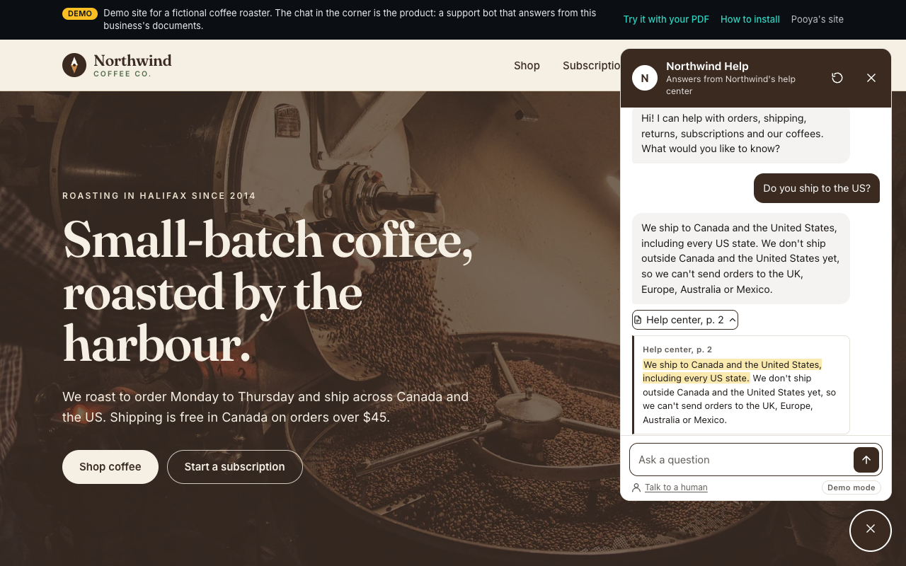
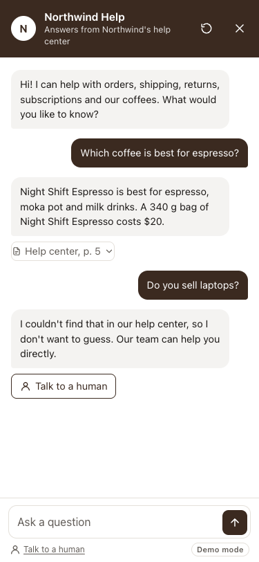
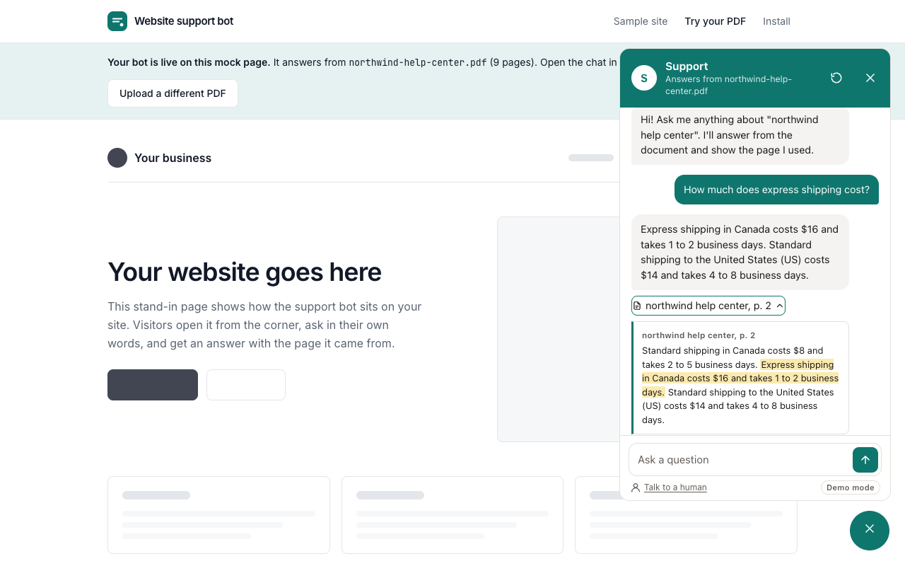
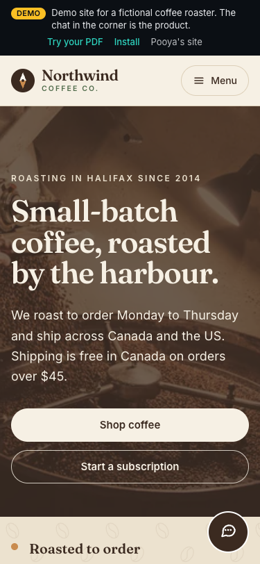
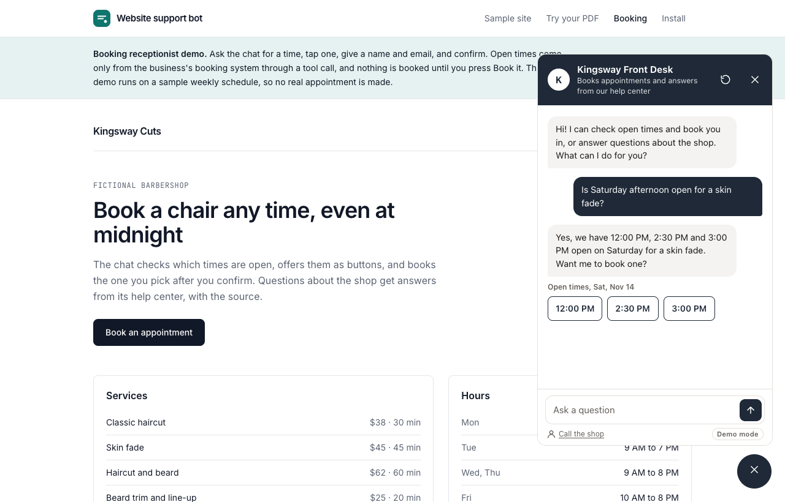
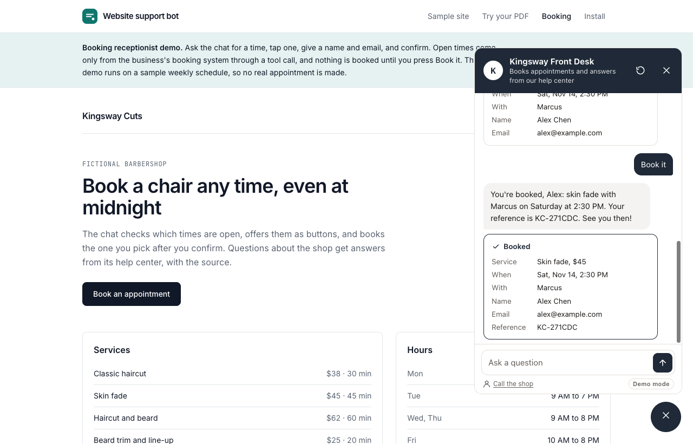
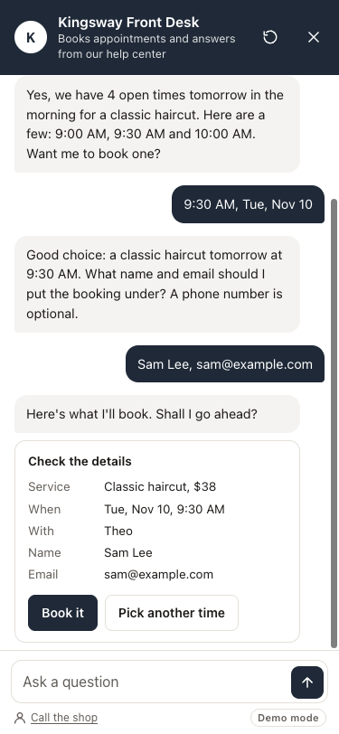
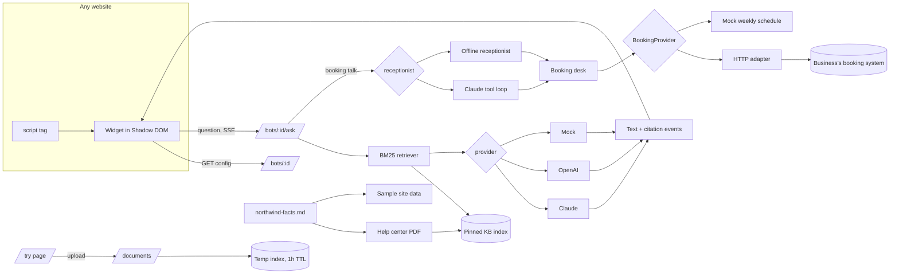

# Website support bot

A chat widget for your website that answers visitors from your own documents. It replies in a few friendly sentences, shows the page of your help center it used, and when your documents don't cover a question it says so and offers a "Talk to a human" link instead of guessing. It installs on any site (Shopify, WordPress, Webflow, Squarespace or custom) with one `<script>` tag.

For businesses that run on appointments, the same widget works as a **24/7 booking receptionist**: it checks real open times in the business's booking system, offers them as buttons ("Yes, we have 2:30 PM and 3:00 PM open on Saturday. Want me to book one?"), takes a name and email, and books the time once the visitor confirms. Times only ever come from the booking system, never from the model.

This repo is a working demo built for small businesses and agencies. The demo site is **Northwind Coffee Co.**, a fictional coffee roaster: the chat bubble in the corner answers from Northwind's customer help center PDF. A "try it with your own PDF" page builds a bot on any document in seconds, and a booking page shows the receptionist on **Kingsway Cuts**, a fictional barbershop.

- **Sample site with the bot:** `/` (plus Shop, Subscriptions, Brew guides, About, Contact)
- **Try it with your PDF:** `/try`
- **Booking receptionist:** `/booking`
- **How to install:** `/install`

The repo name is `docs-chat`; the public name is "Website support bot".

## Screenshots

| Desktop: answer with its source opened | Mobile: full-screen chat with the handoff |
|---|---|
|  |  |

| Try it with your own PDF | Mobile: the sample site |
|---|---|
|  |  |

| Booking: open times as buttons | Booking: confirmed | Mobile: the confirm step |
|---|---|---|
|  |  |  |

More: the [install page](docs/screenshots/install.png), and the widget on a [page with hostile global CSS](docs/screenshots/hostile-css.png).

The sample site uses free Unsplash photos, pre-sized to WebP at build time (Cloudflare Workers has no image optimizer) and served through a small custom `next/image` loader. Every photographer is listed in [CREDITS.md](CREDITS.md) and on the site's `/credits` page.

## Install snippet

```html
<script src="https://coffee.pooya.website/embed/widget.js" data-bot="northwind" data-api="https://api.pooya.website" defer></script>
```

Paste it just before `</body>`. Bot settings (name, greeting, suggested questions, accent colour, handoff link) live on the server, so the snippet stays short. Data attributes override them per site: `data-accent`, `data-position`, `data-greeting`, `data-suggestions`, `data-handoff-url`, `data-handoff-text`, `data-tooltip`, `data-open`. Platform notes are on the `/install` page.

## Architecture



| Folder | What it is |
|---|---|
| `backend/` | FastAPI on Python 3.12: PDF ingestion, a page-aware chunker, BM25 retrieval, Claude/OpenAI/mock adapters behind one interface, SSE streaming, rate limits and cost caps, bot config. `app/booking/` holds the booking provider interface and its adapters, `app/receptionist/` the booking conversation. |
| `widget/` | The embeddable widget: vanilla TypeScript bundled with esbuild into one IIFE, about 10 KB gzipped. Renders in a Shadow DOM. |
| `frontend/` | Next.js 16: the Northwind sample site (its own brand), plus `/try` and `/install` (Pooya's brand). Builds the widget into `public/embed/widget.js`. |

### API

| Method | Path | Purpose |
|---|---|---|
| `GET` | `/bots/{bot_id}` | Public widget config: name, greeting, suggestions, colour, handoff, `mode` (live or demo) |
| `POST` | `/bots/{bot_id}/ask` | `{question, session_id, action?}`, streams SSE. `action` is a widget tap: `{type: "service" \| "day" \| "slot", id}`, `{type: "confirm"}` or `{type: "change"}` |
| `POST` | `/documents` | Upload a PDF for the "try your own" page |
| `POST` | `/documents/{id}/ask` | Ask an uploaded document, streams SSE |
| `GET` | `/health`, `/docs` | Health with provider and limits, and the OpenAPI docs |

The stream sends `meta {provider, notice}`, then `text` deltas and `citation {page, quote, context}` events, then `done {grounded, citations, handoff}` or `error {code, message}`. Booking bots can also send `choices {kind, label, options}` (services, days or open times to tap) and `booking {status, service, when, staff, name, contact, price, reference}`, where `status` is `pending` until the visitor confirms and `confirmed` once it is written.

**CORS is per route.** Bot routes follow each bot's `allowed_origins` (the demo bot allows `*`, so the embed works anywhere, protected by rate limits). Upload and document routes allow only the frontend origin.

## How grounding works

1. **One fact sheet.** `backend/sample/northwind-facts.md` holds every product, price, policy and opening hour. `generate_kb.py` writes both the help center PDF the bot answers from and the JSON the sample site renders, so the site and the bot can't drift apart. A test fails if either is stale.
2. **Pinned knowledge base.** At startup each bot's PDF is ingested once and kept in memory. Uploads on `/try` live in a separate store with a one-hour lifetime.
3. **Retrieval first.** The question (plus the previous question, for follow-ups like "how do I cancel it?") is matched against short passages with BM25. If nothing scores above a threshold, the bot replies "I couldn't find that in our help center" and sets `handoff: true` **without calling a model at all**. "Do you sell laptops?" never costs a token.
4. **Answer only from the passages.** The system prompt speaks as the business's support assistant, asks for two to four sentences, and says to reply with an exact not-found sentence when the passages don't cover the question.
5. **Native citations.** Claude gets each passage as a document with citations enabled and returns character ranges; OpenAI returns structured segments with passage ids. Both are mapped to the same `citation` events, with the page found from the exact character offset. Unknown ids are dropped, and an answer without citations is flagged for the handoff.
6. **Sources visitors can check.** The widget groups citations by page ("Help center, p. 4"), and each chip expands to the passage with the quoted words highlighted.

## How the booking receptionist works

1. **Routing.** On a booking bot, a message goes to the receptionist when it is a widget tap, mentions booking or availability ("any openings", "book", "appointment"), names a service and a day ("fade on Saturday?"), or continues a booking under way. Everything else is a normal help-center answer with citations, so "What's your cancellation policy?" still cites the page.
2. **One booking desk.** Both receptionists go through `app/receptionist/desk.py`, which enforces the rules whichever one is answering: open times only come from the booking provider, only a time that was offered can be booked, details are validated (name, email, optional phone), and a booking is staged first and written only on a **later** message, after the visitor confirms.
3. **Claude with tools.** With a key, Claude runs a short manual tool loop with four strict tools: `list_services`, `check_availability(service, date, time_of_day)`, `request_booking(slot_id, name, email, phone)` and `confirm_booking()`. Inputs are validated with pydantic before anything reaches the booking system, and errors go back as `is_error` tool results. The desk's state (today's date, offered times, the pending booking) is restated in every request. The reply is checked against the times the tools returned: a reply that names any other time is replaced with a safe sentence, so a made-up time never reaches the visitor.
4. **Offline receptionist.** With no key, a deterministic version parses the day ("tomorrow", "Saturday", "Nov 20", "the 21st"), part of day ("morning", "after 4pm"), a specific time, the service and the contact details, then calls the same desk. It powers the free public demo and the tests. Widget taps are handled this way in every mode, since a tap needs no language model.
5. **Edge cases.** A full day points to the next day with openings. A time someone else took between the offer and the confirmation gets "Sorry, 2:30 PM was just booked by someone else" plus fresh times. If the booking system can't be reached, the bot says so and offers the shop's phone number.
6. **Widget.** Open times, services and days render as buttons in a labelled group, and the booking shows as a short card with Book it and Pick another time. Choices and summaries are announced through the `aria-live` region, everything works from the keyboard, and old buttons go quiet once the visitor moves on.

### Pointing it at a real booking system

The receptionist talks to a small `BookingProvider` interface (`app/booking/base.py`: `find_slots(service_id, day)` and `book(slot, customer)`). Two adapters ship:

- **Mock** (default): an in-memory week for three barbers with breaks, about two thirds of times already taken, chosen by a stable hash so every run shows the same openings.
- **HTTP**: set `BOOKING_PROVIDER=http` and `BOOKING_API_URL=https://bookings.example.com`. It expects two JSON endpoints under `/api/sites/{business}`:
  - `GET /availability?service={service_id}&date=YYYY-MM-DD` returns `{"slots": [{"startAt": <epoch ms>, "staffIds": ["..."]}]}`.
  - `POST /bookings` with `{"serviceId", "staffId", "startAt", "name", "email", "phone", "notes"}` returns `201 {"bookingId"}`, `409` when the time was taken, or `400 {"message", "fields"}` for invalid details. When several people were free at that time, the adapter tries each in turn on a `409`.

The service menu and staff names live in `app/booking/catalog.py`, and the bot's `BookingSetup` in `app/bots.py` names the business, its timezone and the phone number to offer when the system is down. A system with a different API needs one new adapter class; the receptionist doesn't change.

## Key decisions and trade-offs

- **Vanilla TypeScript, not Preact.** The widget is small enough that a framework would be most of the bundle. The DOM is built with a tiny `h()` helper and never `innerHTML`, so model output can't inject markup.
- **Shadow DOM with `:host { all: initial !important }`.** Important declarations from the shadow tree win over the host page's, so even `docs-chat-widget { display: none !important }` on the host can't hide it. Sizes are in px so the host's root font size can't scale it. `widget/test/host.html` checks this.
- **Conversation in `sessionStorage`.** It survives page changes on the host site and disappears with the tab. The server keeps the last few turns per session for follow-ups.
- **BM25 instead of embeddings.** Help centers are small and full of exact terms (prices, "pause", "decaf"). BM25 is fast, free and easy to explain, and the threshold makes "I don't know" cheap. The `Retriever` interface leaves room for pgvector.
- **A mock provider that is actually useful.** With no key, answers come from an extractive picker (IDF-weighted, heading-aware) over the same passages, with real citations. The public demo falls back to it when a cap is hit or the provider fails, and the widget shows a small "Demo mode" tag.
- **Two root layouts.** The sample site and the demo pages have different brands, fonts and HTML roots, so moving between them is a full page load and the Northwind widget never leaks onto `/install`.

- **The model never owns the rules.** Confirm-before-booking, "only offered times" and input validation are enforced in code by the booking desk, not by the prompt, so they hold even if the model is wrong or the visitor argues.
- **Deterministic taps.** Choosing a time or pressing Book it never calls the model. That keeps the flow fast and cheap, and only free-text booking messages use the paid provider. With OpenAI selected, booking messages use the offline receptionist; the tool loop is Claude-only for now.

### What I'd do next in production

- Postgres with pgvector for chunks and embeddings (hybrid search with BM25), object storage for uploaded files, and Redis for sessions and rate limits so the API can scale past one instance.
- A small admin for bot config (greeting, colours, allowed origins) and several documents per bot.
- Handoff into a helpdesk (email ticket or live chat) with the transcript attached.
- Analytics on unanswered questions, which point straight at gaps in the help center.
- Short holds in the booking system while a visitor confirms, booking state in Redis, and an OpenAI version of the booking tools.

## Run locally

Needs [uv](https://docs.astral.sh/uv/) and Node 22 (`nvm use` in `frontend/` or `widget/`).

```bash
make install   # uv sync, npm ci for the widget and the frontend
make dev       # backend on 8010, widget watcher, sample site on 3010
```

Open http://localhost:3010. Without API keys everything runs in mock mode. Add `ANTHROPIC_API_KEY` (or `OPENAI_API_KEY` and `OPENAI_MODEL`) to `backend/.env` for live answers.

| Command | What it does |
|---|---|
| `make test` | Backend pytest and widget unit tests |
| `make lint` | ruff, widget typecheck, frontend ESLint |
| `make widget` | Build `widget.js` with the 30 KB gzipped size check, and copy it into the frontend |
| `make widget-host` | Serve the hostile-CSS page at http://localhost:8099/test/host.html |
| `make kb` | Regenerate the help center PDFs (Northwind and Kingsway) and the site data from the fact sheet |
| `make check` | Everything above plus the frontend production build |

### Backend environment variables (`backend/.env`)

| Variable | Default | Purpose |
|---|---|---|
| `LLM_PROVIDER` | empty | `anthropic`, `openai` or `offline`. Empty picks by available key, else mock. |
| `ANTHROPIC_API_KEY` | empty | Claude key |
| `ANTHROPIC_MODEL` | `claude-opus-5-5` | Use `claude-haiku-5-5` for the public demo |
| `ANTHROPIC_EFFORT` | `medium` | Sent as `output_config.effort` |
| `OPENAI_API_KEY`, `OPENAI_MODEL` | empty | OpenAI key and model (required together) |
| `CORS_ORIGINS` | `http://localhost:3010` | Origins allowed on upload and document routes |
| `PUBLIC_SITE_URL` | `http://localhost:3010` | Base for the bot's "Talk to a human" link (`/contact`) |
| `PUBLIC_DEMO` | `false` | `true` applies 5 MB / 25 pages, 10 live answers per IP per hour, 300 per day, 1 hour uploads |
| `TRUST_PROXY_HEADERS` | `false` | Use `X-Forwarded-For` behind Cloud Run |
| `ASK_RATE_LIMIT_PER_MINUTE` | `20` | Per-IP question rate limit |
| `FALLBACK_TO_MOCK` | `true` | Use mock mode when a cap is hit or the provider fails |
| `BOOKING_PROVIDER` | `mock` | `mock` (built-in weekly schedule) or `http` (the business's booking system) |
| `BOOKING_API_URL` | empty | Base URL of the booking system for the HTTP adapter |
| `BOOKING_TIMEOUT_SECONDS` | `8` | Timeout for booking system calls |
| `BOOKING_MAX_TOOL_ROUNDS` | `6` | Most tool rounds Claude may take for one booking message |

Bots themselves are defined in `backend/app/bots.py`.

### Frontend environment variables (`frontend/.env.local`)

| Variable | Default | Purpose |
|---|---|---|
| `NEXT_PUBLIC_API_URL` | `http://localhost:8010` | The API the sample site's snippet and `/try` talk to |

Personal links and the public URLs used in the install snippet live in `frontend/src/config/site.ts`.

## Deploy

Nothing here deploys automatically. Phase 1 uses the free `*.run.app` and `*.workers.dev` URLs; phase 2 points `api.pooya.website` and `coffee.pooya.website` at them.

### Backend on Google Cloud Run

```bash
cd backend
gcloud run deploy docs-chat-api \
  --source . \
  --region us-central1 \
  --allow-unauthenticated \
  --min-instances 0 --max-instances 1 \
  --memory 512Mi \
  --set-env-vars "PUBLIC_DEMO=true,ANTHROPIC_MODEL=claude-haiku-5-5,TRUST_PROXY_HEADERS=true,CORS_ORIGINS=https://coffee.pooya.website,PUBLIC_SITE_URL=https://coffee.pooya.website" \
  --set-secrets "ANTHROPIC_API_KEY=anthropic-api-key:latest"
```

- Create the secret first: `printf '%s' "$KEY" | gcloud secrets create anthropic-api-key --data-file=-`.
- `--max-instances 1` keeps the in-memory documents, quotas and history consistent.
- Set a monthly spend limit and a small prepaid balance on the Anthropic account. If the credit runs out, the bot falls back to demo mode.
- For `api.pooya.website`, map the domain with `gcloud beta run domain-mappings create` and add the DNS record it prints.

The image builds and runs locally: `cd backend && docker build -t docs-chat-api . && docker run -p 8080:8080 -e LLM_PROVIDER=offline docs-chat-api`.

### Frontend and widget on Cloudflare Workers (OpenNext)

```bash
cd frontend
npx wrangler login
NEXT_PUBLIC_API_URL=https://api.pooya.website npm run deploy
```

The frontend's `prebuild` step builds `../widget` into `public/embed/widget.js`, so every deploy ships the matching widget at `/embed/widget.js`. `npm run preview` serves the worker locally. For `coffee.pooya.website`, add a custom domain to the worker in the Cloudflare dashboard.

Built by Pooya Nikbakht.
